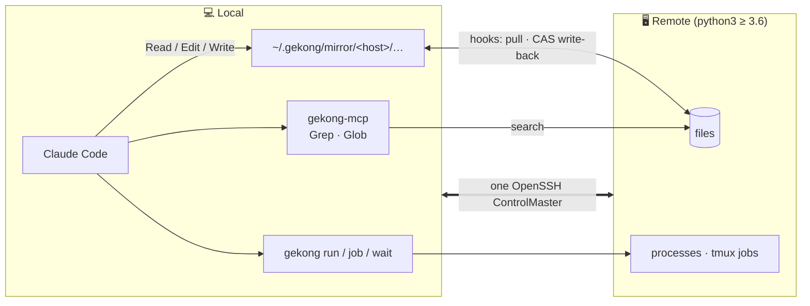

<div align="center">

# 🪄 gekong

<sub><i>gekong</i> is 隔空 (gé kōng), Chinese for "from across a distance", as in 隔空取物: moving things without touching them.</sub>

**A remote toolkit for coding agents, built on OpenSSH connection multiplexing.**

Log in once. Then let Claude Code read, edit, search and run on your remote boxes<br>
as if they were local, with nothing to install on the remote.


<br>



<sub>The terminal output is real gekong output; the Claude Code session is an illustration.</sub>

<br>

[Why not …?](#-why-not-) · [Install](#-install) · [Security](#-security--disclaimer) · [Quick start](#-quick-start) · [How it works](#-how-it-works) · [Commands](#-commands) · [Slow shells](#-slow-remote-shells) · [Tests](#-tests)

</div>

---

## ✨ Highlights

|  |  |
| --- | --- |
| 🔐 **Log in once** | `gekong up` opens one SSH master (2FA and all). Every later call is a new channel on it, with no extra handshake. |
| 📝 **Native file tools** | Claude Code edits remote files with its own **Read / Edit / Write** through a local mirror. |
| 🔎 **Remote search** | **Grep / Glob** over MCP run on the remote, so the agent searches the whole tree rather than only what's been mirrored. |
| ⚡ **Remote commands** | `gekong run` for one-off commands; `gekong job` + `gekong wait` for long runs in remote tmux. |
| 🛑 **Clean stops** | Stopping a local command stops its remote process group too. No orphans left on the GPU box. |
| 🪶 **Zero install remotely** | The remote only needs `python3` (≥ 3.6). Nothing gets installed there. |

## 🤔 Why not …?

**…just let the agent call `ssh`?**
Every call is a fresh login, and an agent can't type a 2FA code. It ends up editing files with `sed` and heredocs instead of its own Edit tool. And killing a local `ssh` doesn't stop the remote process, so interrupted commands keep running on the box. gekong logs in once, gives the agent its native file tools, and takes the remote process group down with the local command.

**…mount the remote with sshfs?**
The agent's Grep / Glob would walk the whole tree over the wire, including datasets and checkpoints. Edits land blindly on whatever is there, and a dropped link can wedge the mount. gekong runs searches on the remote, only pulls files the agent actually reads, and writes back with compare-and-swap, so it never overwrites a change made behind its back.

**…sync the project with rsync / mutagen?**
Every rsync opens a new SSH connection, so on a 2FA host each sync means another code from your phone, and an agent can't sync on its own at all. You also end up with two copies that drift. Outputs, logs and big files live on the remote, and each sync either misses them or drags them over. With gekong the remote stays the single source of truth; the mirror is just a cache of the files the agent has read. When you do want rsync, `rsync -e 'gekong ssh'` reuses gekong's login, with no extra 2FA.

**…run Claude Code on the remote itself?**
You'd install it and put your credentials on a machine you may share with others, often a login node. You'd also leave your local settings, MCP servers and skills behind. And you'd need one session per host. gekong keeps one local agent that can work on several hosts, and leaves nothing behind on them.

## 📦 Install

```bash
uv tool install --editable .     # gekong, gekong-mcp, gekong-hook -> ~/.local/bin
gekong setup claude              # hooks, permissions, mirror directory, MCP server, skill
```

`gekong setup claude` backs up `settings.json` before changing it.

| Flag | Effect |
| --- | --- |
| `--dry-run` | Print the `settings.json` it would write |
| `--uninstall` | Remove only what setup added |

**Permissions.** Setup pre-approves the subcommands agents work with and the read-only ones:
`gekong run` · `job` · `wait` · `status` · `ps` · `tail`.
`gekong up` · `down` · `kill` · `setup`, plain `ssh` and `gekong ssh` still ask you first.
`gekong ssh` passes any ssh option through, port forwards included, so it gets the same treatment as `ssh`.

## 🔒 Security & disclaimer

gekong is early (0.1.0) and experimental. Read this before pointing it at machines you care about.

- **The agent gets a shell on your hosts.** After `gekong setup claude`, Claude Code can run any command on a connected host through `gekong run` / `gekong job` without asking, with your privileges there. Only connect hosts you're willing to hand to an agent, and take extra care on shared clusters.
- **A connection stays open until you close it.** `gekong up` keeps the SSH master alive with no timeout. While it's up, anything running as your local user can use it without going through 2FA again. Run `gekong down` (or `gekong down --all`) when you're done.
- **Remote files are copied to your machine.** Every file the agent reads is cached in plain text under `~/.gekong/mirror` and isn't cleaned up automatically. Mind secrets, `.env` files and restricted data.
- **Edits aren't backed up.** Write-back is compare-and-swap, so it won't clobber a concurrent change, but nothing keeps old versions. Keep important work in git.
- **Check your site's rules.** Some clusters and employers don't allow persistent or multiplexed SSH connections, or heavy work on login nodes (`gekong job` runs on whatever host you connected to). Following their acceptable-use policy is up to you.
- **Platforms.** Local: macOS and Linux, since gekong relies on OpenSSH connection multiplexing, which the Windows build of OpenSSH lacks. Remote: Linux with python3 ≥ 3.6.

gekong is provided as is, without warranty of any kind; see [LICENSE](LICENSE).

## 🚀 Quick start

```bash
gekong up gpu1                                  # log in once in your terminal (2FA etc.)
gekong status                                   # connections and per-call latency
gekong run gpu1 'nvidia-smi'                    # one-off command

gekong job start --name train gpu1 'python train.py'
gekong wait gpu1 --job train --pattern 'epoch 5/'

gekong down gpu1
```

Then just ask Claude Code to work on `gpu1`; the installed skill and MCP server show it how.

## 🧭 How it works



A remote file `/abs/path` on `host` lives locally at `~/.gekong/mirror/<host>/abs/path`.

1. **Before a Read**, a hook pulls the latest version from the remote.
2. **After an Edit / Write**, a hook writes it back to the remote atomically, as a compare-and-swap.
3. **If the remote changed** since the model read it, the edit is refused and the model reads it again.

## 🧰 Commands

| Command | What it does |
| --- | --- |
| `gekong up HOST` | Connect: open the SSH master (interactive login, 2FA) |
| `gekong down [HOST] [--all]` | Disconnect |
| `gekong status [HOST]` | Show connections |
| `gekong run HOST 'CMD'` | Run a command |
| `gekong job start [--name N] [-C DIR] HOST 'CMD'` | Start a long job in remote tmux |
| `gekong job ls / tail / kill HOST JOB` | List, read or stop jobs |
| `gekong wait HOST --job J \| --file F [--pattern RE]` | Wait for a log line or for a job to finish |
| `gekong ssh HOST` | Interactive shell over the master |
| `gekong ps [HOST] [-a]` | List commands started by agents |
| `gekong tail ID [-n N] [-f]` | Show a command's output |
| `gekong kill ID` | Stop a command |
| `gekong setup claude` | Integrate with Claude Code |

> [!TIP]
> `gekong ssh` is a drop-in for `ssh` wherever a tool takes one:
> `rsync -e 'gekong ssh' …` or `GIT_SSH_COMMAND='gekong ssh' git …`

> [!NOTE]
> `gekong job` needs `tmux` on the remote. Everything else needs only `python3`.

## 🐢 Slow remote shells

Every call goes through the remote login shell, and sshd makes it source `~/.bashrc`. On HPC login nodes the `/etc/profile.d` scripts can take a second or two, and `gekong status` then reports more than 1 s per call.

Put this line at the **very top** of the remote `~/.bashrc`:

```bash
[[ $BASH_EXECUTION_STRING == *gekong:call* ]] && return   # gekong's file reads, writes and searches need no setup
```

| Tag | Used by | rc file |
| --- | --- | --- |
| `gekong:call` | file reads, writes, searches | skipped |
| `gekong:run` | `gekong run` / `gekong job` | loaded in full, so `module` and the like work as usual |

Either way the rc file is sourced at most once per command.

## 🧪 Tests

```bash
uv run pytest tests/unit                                                # no Docker needed
uv run pytest                                                           # + sshd container e2e tests and a python 3.6 test
GEKONG_CLAUDE_SMOKE=1 uv run pytest tests/e2e/test_claude_smoke.py -s   # real `claude -p` (spends tokens)
```

---

<sub>[MIT](LICENSE) © 2026 Chiming NI. gekong is an independent project, not affiliated with or endorsed by Anthropic. Claude and Claude Code are trademarks of Anthropic.</sub>
